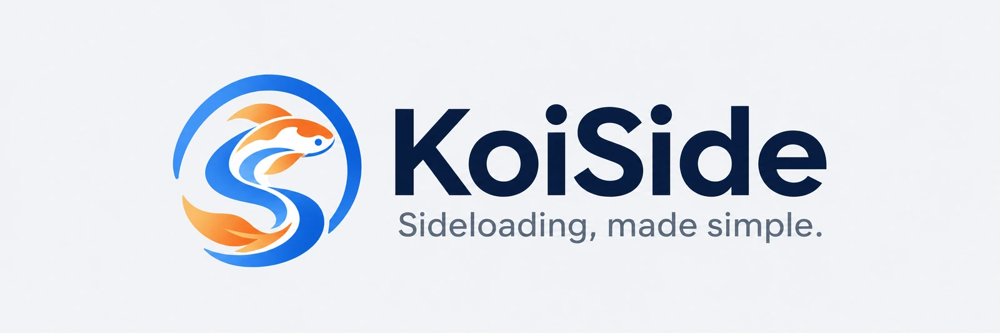
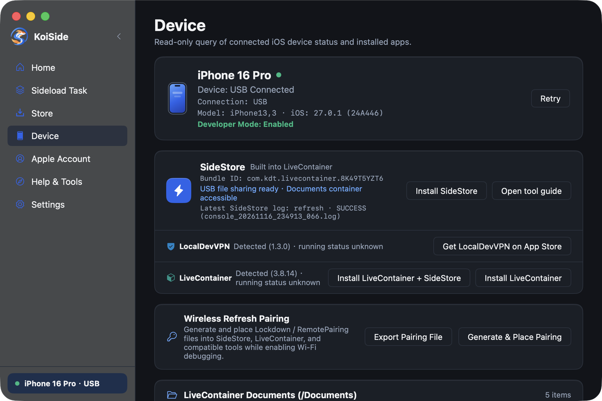
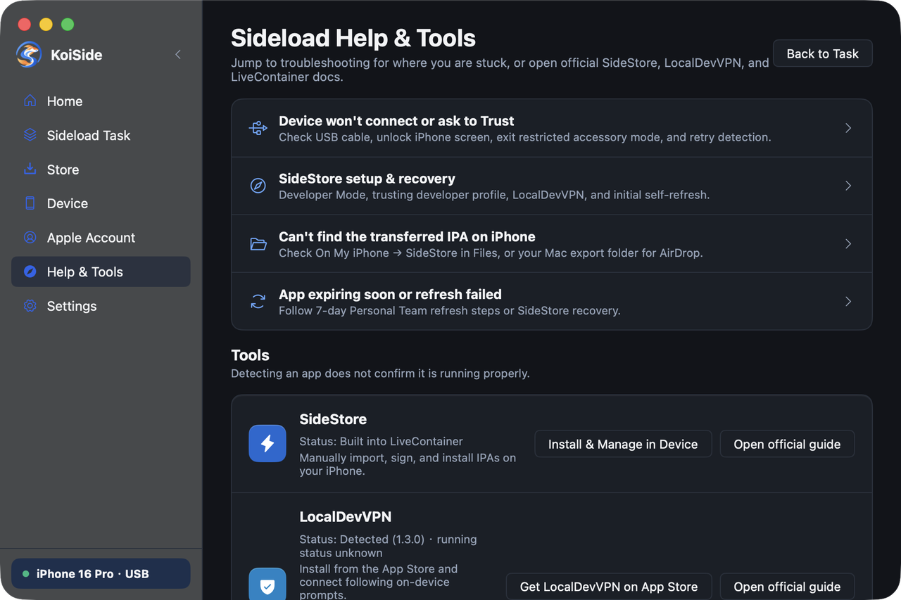

<div align="center">



**Prepare, sign, and sideload your own iPhone apps with guidance along the way.**

[](https://github.com/wayjam/koiside/releases)
[](https://go.dev/)

[Download](https://github.com/wayjam/koiside/releases) · [Build from source](#build-from-source) · [Report an issue](https://github.com/wayjam/koiside/issues)

</div>

## Why KoiSide?

Start with an IPA and follow a guided sideloading workflow. KoiSide helps you inspect the file, choose an installation route, make optional changes, and find the next step on your iPhone. Return later to continue a task or review refresh instructions.

Built in Go with [mygo](https://github.com/egoist/mygo), KoiSide uses GPU-rendered native UI with light and dark appearances. Device communication and IPA preparation run within the app, with macOS system services handling the connection to your iPhone.

## Features

- **Inspect and prepare IPA files.** Check metadata, architectures, FairPlay encryption, provisioning information, extensions, and Watch components. Preview display-name or Bundle ID changes and export a new copy while preserving the input file. Inspection and export work offline.
- **Choose how to sideload.** Hand off an IPA over USB to SideStore or LiveContainer where file sharing is available, or use desktop signing and USB installation. Free Personal Team accounts are supported for development signing.
- **Set up your device.** Check connected iPhones and installed apps, prepare pairing files, and follow setup instructions for SideStore, LocalDevVPN, and LiveContainer.
- **Manage Apple accounts.** Use a shared account interface for App Store and developer services, with service-specific sessions and signing credentials. App Store search and downloads depend on Apple's services and account region.
- **Use KoiSide in your language.** Switch between Simplified Chinese, English, Russian, and Japanese.
- **Use the CLI or MCP server.** Inspect files, query devices, and automate supported operations from the same executable.

## Screenshots

| Device & pairing | Sideload help & tools |
| --- | --- |
|  |  |

## Install

Requires **macOS 26 or later on Apple Silicon**.

1. Download the macOS arm64 build from [Releases](https://github.com/wayjam/koiside/releases).
2. Extract the archive or open the disk image and move **KoiSide.app** to **Applications**.
3. Open KoiSide and select an IPA. Connect and unlock your iPhone when prompted, then confirm **Trust** on the device.

For an ad-hoc signed build that macOS blocks, review the app's source and follow Apple's instructions for opening an app from an unidentified developer. [Apple's opening instructions](https://support.apple.com/en-us/102445)

### Sideloading requirements

- Use an IPA suitable for your chosen installation route. App Store downloads can retain FairPlay encryption and require a different, sideloadable build for re-signing.
- Free Personal Team provisioning profiles expire after seven days. Refresh before expiry through your chosen workflow. KoiSide's guides explain when to use SideStore, LocalDevVPN, Wi-Fi, and iOS Developer Mode.
- USB file transfer and installation have separate results. After a SideStore handoff, complete the installation on your iPhone. LiveContainer runs imported apps inside its container, with compatibility depending on the app and configuration.

## Build from source

Install **Go 1.27.3 or later**, as specified in [go.mod](go.mod).

```sh
git clone https://github.com/wayjam/koiside.git
cd koiside

# Run the desktop app
go run ./cmd/koiside

# Build the Apple Silicon app bundle
go tool mygo build -platform darwin/arm64 -skip-dmg

# Open the built application
open build/darwin-arm64/KoiSide.app
```

Omit `-skip-dmg` to also produce a disk image.

### CLI and MCP

The bundled executable is available at `/Applications/KoiSide.app/Contents/MacOS/KoiSide`. From a source checkout, run the following commands.

```sh
# Inspect an IPA
go run ./cmd/koiside ipa inspect /path/to/app.ipa --json

# Query a connected iPhone
go run ./cmd/koiside device status --json

# Start the MCP stdio server
go run ./cmd/koiside mcp
```

## Development

```sh
go tool revive -config revive.toml ./...
go vet ./...
go vet -tags e2e ./...
go test -count=1 ./...
```

## Acknowledgments

- [mygo](https://github.com/egoist/mygo) provides the native GPU-rendered Go UI framework.
- [SideStore](https://sidestore.io/) provides on-device sideloading and refresh workflows.
- [LiveContainer](https://github.com/LiveContainer/LiveContainer) provides an on-device app container runtime.
- [Phosphor Icons](https://phosphoricons.com/) provides the interface icons.
